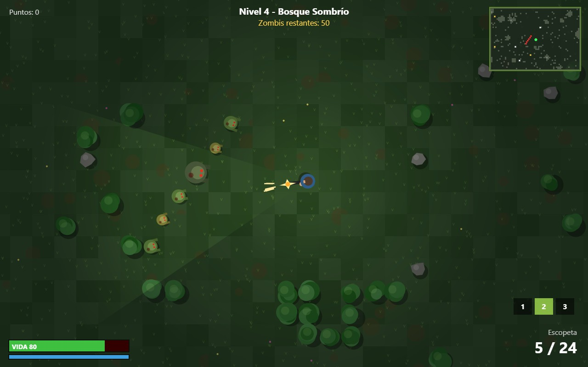

# 🧟 Zona Muerta

Juego de acción y supervivencia con **vista desde arriba**, hecho con HTML5 y JavaScript.
Se juega en el navegador de la PC o se instala en el celular como **app (PWA)**.



## 🎮 Jugar
- **Jugar en línea:** https://joseblncxx.github.io/zona-muerta/
- **En tu PC:** descarga este repositorio, entra a `Juego_ZonaMuerta` y abre `index.html` con doble clic.
- **En tu celular:** abre el enlace en línea y elige **"Instalar app"** (Android) o **"Agregar a inicio"** (iPhone).

No necesitas instalar nada ni tener Internet para jugar.

## ✨ Características
- **Modo Historia**: 13 niveles con diálogos y misiones (eliminar, rescatar, defender y escapar en helicóptero)
- **Modo Supervivencia**: oleadas infinitas con récord y un jefe cada 5 oleadas
- **9 mapas**: ciudad, hospital, bosque, centro comercial, laboratorio, metro, base militar, aeropuerto y cementerio
- **Clima y ciclo de día/noche**: lluvia, niebla y tormentas con relámpagos
- **10 jefes** que se enfurecen a mitad de vida
- **9 armas** (2 legendarias que solo sueltan los jefes), machete y granadas
- **Trampas**: torretas, minas, barricadas y barriles explosivos
- **Enemigos**: normales, corredores, tanques, vomitadores, perros, explosivos, gritones y blindados
- **Progreso**: tienda con mejoras y skins, experiencia y habilidades, 20 logros, estrellas y récords
- **Compañeros** con clases (soldado, médica, francotirador, escopetera) y el perro Max, con órdenes
- **Música dinámica** y menú de opciones
- **Autoapuntado**, controles táctiles y sonidos generados por código

## ⌨️ Controles (PC)
| Tecla | Acción |
|---|---|
| W A S D / Flechas | Moverse |
| Mouse · Clic | Apuntar · Disparar |
| Shift | Activar / desactivar correr |
| R | Recargar |
| 1 – 9 / Rueda | Cambiar arma |
| V · G | Machete · Granada |
| C · X · Z | Torreta · Mina · Barricada |
| O | Órdenes a compañeros |
| Q · E | Botiquín · Adrenalina |
| T · M · P | Autoapuntado · Silenciar · Pausa |

## 📁 Contenido
```
Juego_ZonaMuerta/   El juego (index.html + core, mapas, datos, audio, game, ui .js + PWA)
Portafolio/         Instrucciones de descarga y diseño de empaque
ZonaMuerta.zip      El juego comprimido para descargar
```
